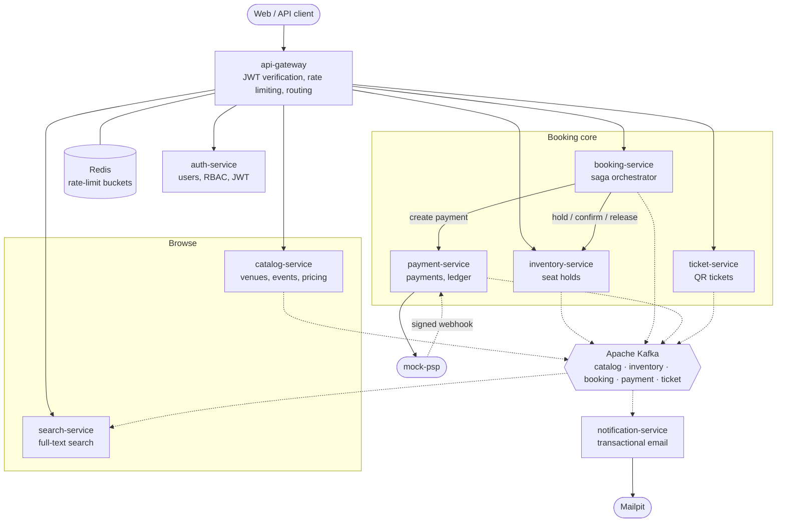
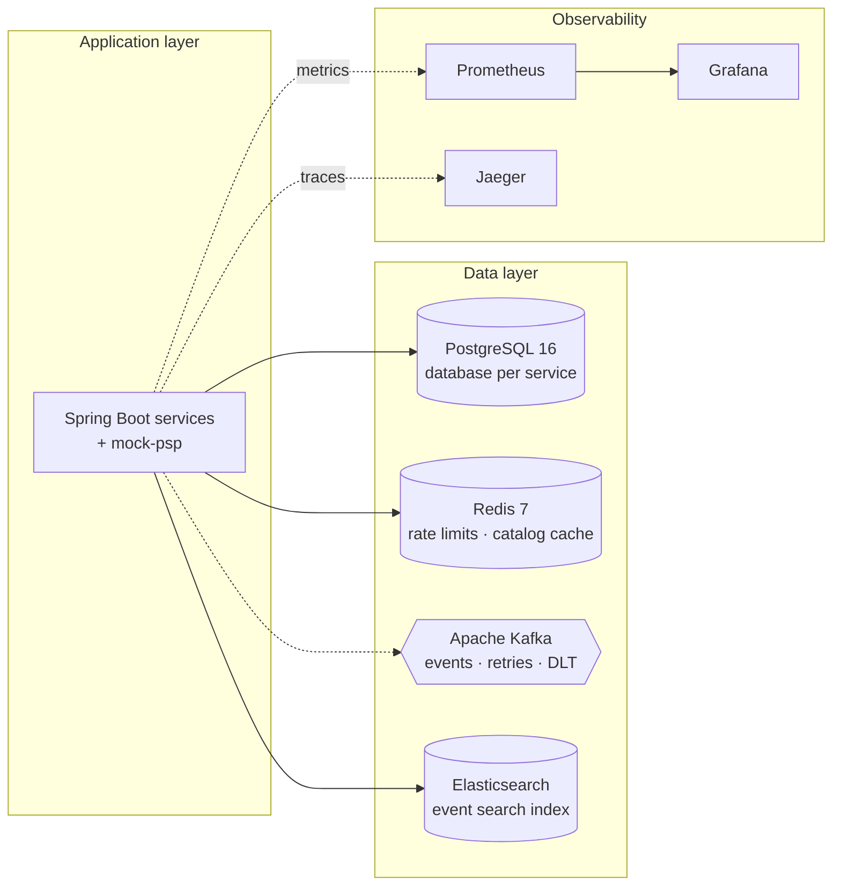
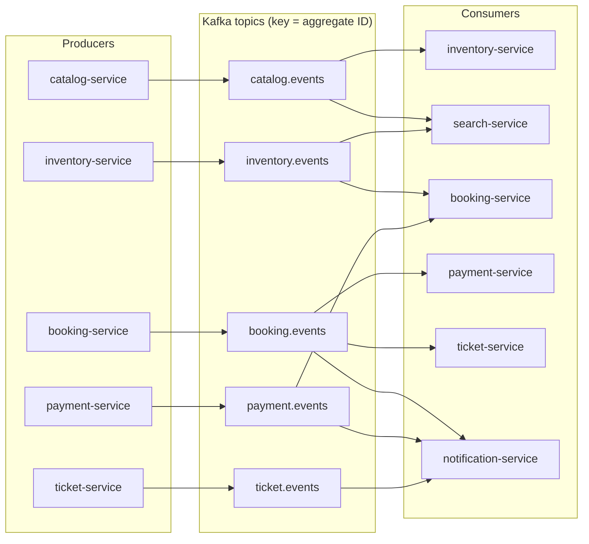
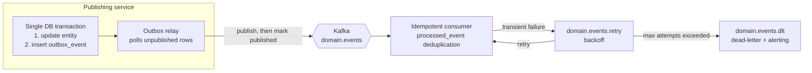
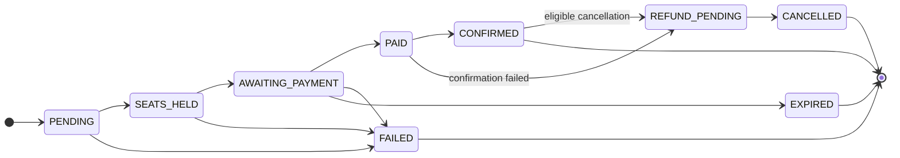
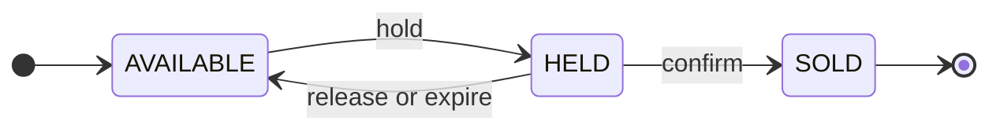
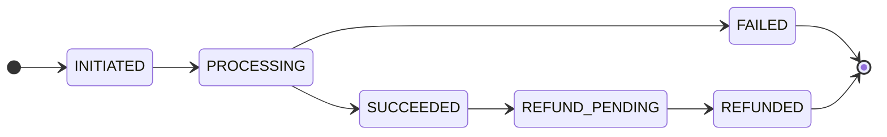
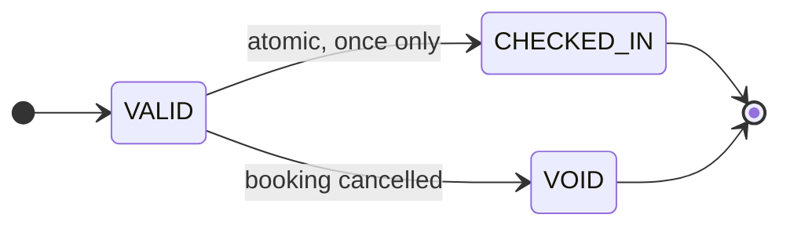
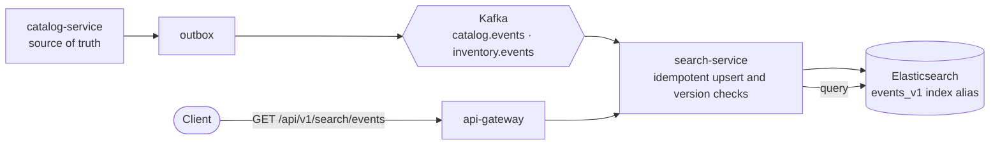

<div align="center">

# TicketRush

**A full-stack event ticketing platform built with Java microservices and a web frontend.**

Features seat reservations, coordinated booking and payment workflows, event-driven services, and fast event discovery.

[](https://www.java.com/)
[](https://spring.io/projects/spring-boot)
[](https://kafka.apache.org/)
[](https://www.postgresql.org/)
[](https://redis.io/)
[](https://elastic.co/)
[](https://www.docker.com/)

</div>

---

## Contents

1. [Overview](#1-overview)
2. [System architecture](#2-system-architecture)
3. [Services](#3-services)
4. [Event-driven backbone](#4-event-driven-backbone)
5. [Booking saga](#5-booking-saga)
6. [State machines](#6-state-machines)
7. [Search read model](#7-search-read-model)
8. [Authentication and authorization](#8-authentication-and-authorization)
9. [Infrastructure](#9-infrastructure)
10. [Design patterns](#10-design-patterns)
11. [Tech stack](#11-tech-stack)
12. [Repository layout](#12-repository-layout)

---

## 1. Overview

When a popular event goes on sale, thousands of people compete for a limited number of seats within minutes. Systems that are not designed for this rush can oversell seats, charge customers twice, or become unavailable. TicketRush is designed around that challenge.

### Design guarantees

| Guarantee | Meaning |
| --- | --- |
| **No double-selling** | Multiple users may request the same seat at the same time, but only one can acquire it. |
| **Money and tickets agree** | A successful charge must lead to a valid booking or a compensating refund if confirmation cannot complete. |
| **Recovery from partial failure** | Crashes, dropped connections, and delayed payment responses are handled through retries, persisted workflow state, and compensating actions. |
| **Responsive browsing under load** | Search and event pages are separated from the concurrency-sensitive booking path. |

The platform is designed to prevent duplicate seat sales, keep booking and payment states consistent, recover from partial failures, and keep event discovery responsive during traffic spikes.

### Users and roles

| Role | Capabilities |
| --- | --- |
| **Guest** | Search and browse events, view seat maps, availability, and prices. |
| **Customer** | Register and log in, hold seats, pay, view bookings and QR tickets, cancel eligible bookings, and receive booking notifications. |
| **Organizer / Admin** | Manage venues, seat layouts, events, pricing, and sales; administer user roles. |
| **Staff** | Scan QR tickets and check them in. Each ticket can be checked in only once. |

---

## 2. System architecture

Every client request enters through the **API gateway**. Each service owns its own database and does not query another service's tables. Services communicate synchronously over REST when an immediate response is needed and asynchronously through **Kafka** for downstream state propagation.

The diagram reads top to bottom: a client reaches the gateway, which routes requests to the owning service. The booking path calls inventory and payment synchronously, while services publish domain events to Kafka for consumers such as search and notifications.



### Reading the diagram

| Line style | Meaning |
| --- | --- |
| Solid arrow | Synchronous REST/HTTP request. Inter-service calls should have timeouts and appropriate resilience controls. |
| Dashed arrow | Asynchronous event flow through Kafka, or a webhook. |
| Booking service | The saga orchestrator that drives the multi-step booking workflow. |

`/internal/**` endpoints are intended for service-to-service use and must not be exposed through public gateway routes.

### Platform and observability view



---

## 3. Services

| Service | Responsibility |
| --- | --- |
| **api-gateway** | Public entry point for JWT verification, rate limiting, and routing. Contains no domain business logic. |
| **auth-service** | Registration, login, token issuance, roles, and permissions. |
| **catalog-service** | Source of truth for venues, events, and price tiers. It does not own live seat availability. |
| **inventory-service** | Source of truth for seat state and time-limited holds. This is the most concurrency-sensitive service. |
| **booking-service** | Owns the purchase workflow and runs the orchestrated saga with compensating actions. |
| **payment-service** | Payment-provider integration, refunds, and payment ledger. |
| **ticket-service** | Issues signed QR tickets and handles check-in. |
| **search-service** | Rebuildable full-text search projection; never the source of truth. |
| **notification-service** | Sends email in response to domain events. |
| **mock-psp** *(tool)* | Simulated payment provider for local development and failure testing. |

The gateway routes REST requests to services. The booking service calls inventory and payment directly over REST with timeouts and resilience controls. Kafka handles asynchronous propagation and reactions to domain events.

---

## 4. Event-driven backbone

Cross-service state propagation uses five Kafka topics. Services use a **transactional outbox** so that a database change and the corresponding event record are committed in the same local transaction. Publishing from the outbox is asynchronous, so delivery can be delayed and must be retried safely.



| Topic | Example events |
| --- | --- |
| `catalog.events` | `EventPublished`, `EventUpdated`, `EventCancelled` |
| `inventory.events` | `SeatsHeld`, `SeatHoldFailed`, `SeatHoldExpired`, `SeatsReleased`, `SeatsSold`, `EventSoldOut` |
| `booking.events` | `BookingCreated`, `BookingConfirmed`, `BookingFailed`, `BookingExpired`, `BookingCancelled`, `RefundRequested` |
| `payment.events` | `PaymentSucceeded`, `PaymentFailed`, `RefundCompleted` |
| `ticket.events` | `TicketsIssued`, `TicketVoided`, `TicketCheckedIn` |

### Messaging rules

| Aspect | Rule |
| --- | --- |
| Topic naming | `<domain>.events`; retry and dead-letter topics use `<domain>.events.retry` and `<domain>.events.dlt`. |
| Partition key | Use the aggregate ID (`bookingId`, `eventId`, etc.) when per-aggregate ordering is required. |
| Envelope | Shared `EventEnvelope`: `eventId`, `eventType`, `aggregateType`, `aggregateId`, `version`, `occurredAt`, `correlationId`, and `payload`. |
| Delivery | At-least-once. Consumers must be idempotent and deduplicate by `eventId`, for example with a `processed_event` table. |
| Schema evolution | Prefer additive changes within a compatible schema version. Breaking changes should use an explicit versioning strategy. |
| Consumer groups | Use a distinct consumer group for each independently consuming service and topic. |

### Outbox, retry, and dead-letter flow



The relay can publish an event and crash before marking its outbox row as published. The event may then be published again after restart, which is why consumers must be idempotent.

---

## 5. Booking saga

`booking-service` is the **saga orchestrator**. It persists progress, such as `booking_saga.current_step`, so a restarted service can resume or reconcile an in-progress workflow. Each step and compensation should be idempotent.

### Happy path

The booking workflow is asynchronous after payment initiation, so the client receives a booking ID and can poll for the final status.

1. **Submit booking:** The customer sends `POST /api/v1/bookings` with an `Idempotency-Key`. The API gateway verifies the JWT and forwards the request to `booking-service`.
2. **Create booking:** `booking-service` persists a booking with status `PENDING`.
3. **Hold seats:** The booking service calls `inventory-service` at `POST /internal/holds`. Inventory atomically holds all requested seats or rejects the request, then returns `holdId`, `expiresAt`, and prices.
4. **Initiate payment:** The booking service records `SEATS_HELD` and asks `payment-service` to create a payment using an idempotency key. The payment service calls `mock-psp` and records the payment state.
5. **Return pending response:** The booking service records `AWAITING_PAYMENT` and returns the booking ID. The client polls the booking status rather than waiting for the entire payment workflow.
6. **Process payment result:** The payment provider sends a signed webhook to `payment-service`. The service verifies and deduplicates the webhook, then publishes `PaymentSucceeded` to Kafka through its transactional outbox.
7. **Confirm booking:** `booking-service` consumes `PaymentSucceeded`, records `PAID`, and asks inventory to confirm the hold. Inventory transitions the held seats to `SOLD`.
8. **Issue tickets and notify:** The booking service records `CONFIRMED` and publishes `BookingConfirmed`. `ticket-service` issues QR tickets and publishes `TicketsIssued`; `notification-service` consumes the relevant events and emails the confirmation and tickets.

The exact event timing is eventually consistent: ticket issuance and notification may happen shortly after the booking becomes confirmed.

### Failure and compensation paths

| Situation | Intended behavior |
| --- | --- |
| Seat hold fails because another user got the seat | Mark booking `FAILED` and return a clear reason. |
| Payment fails or times out | Release the hold and mark the booking `FAILED` or `EXPIRED`, according to the outcome. Ambiguous payment outcomes require reconciliation before assuming no charge occurred. |
| Hold expires while payment is pending | Mark the booking `EXPIRED`; if payment later succeeds, initiate a refund or another explicitly defined recovery action. |
| Payment succeeds, but seat confirmation fails | Request a refund, track `REFUND_PENDING`, and mark the booking `CANCELLED` only after the refund outcome is resolved. |
| Booking service crashes mid-saga | Recover using persisted saga state and reconcile with inventory/payment before retrying uncertain operations. |
| Inventory or payment is slow | Apply timeouts and circuit breakers, while ensuring the saga records and recovers from uncertain outcomes. |
| User retries a booking request | The same `Idempotency-Key` returns the original operation rather than creating duplicate side effects. |

> **Design note:** Ticket issuance is outside the core payment/seat-confirmation saga. If ticket issuance fails after a booking is confirmed, it should be retried and monitored rather than silently undoing a legitimate purchase.

---

## 6. State machines

State machines document allowed transitions and help services reject invalid state changes.

### Booking



The exact transition rules must account for late payment callbacks and uncertain provider outcomes. For example, a late success callback after expiry must not be ignored if money was captured.

### Seat



### Payment



### Ticket



Seat holds have their own lifecycle: `ACTIVE`, then `CONFIRMED`, `RELEASED`, or `EXPIRED`.

---

## 7. Search read model

Search is a **projection**, not a source of truth. If the index is lost, it can be rebuilt by replaying retained Kafka events or bulk-loading source data from the catalog service.



- **Does:** full-text search, fuzzy matching, autocomplete, filters and facets (city, date, category, price), geo queries, and relevance sorting.
- **Does not:** serve authoritative seat-level availability, accept client writes, or store data that cannot be rebuilt.
- **Consistency trade-off:** stale search results are acceptable; checkout always asks inventory for current seat state.
- **Operations:** document version checks reject older updates where supported. Zero-downtime reindexing builds a new index and switches an alias.

---

## 8. Authentication and authorization

Authorization is layered so that `auth-service` does not need to be called for every authenticated request.

### Authentication request flow

1. **Login:** The client sends `POST /api/v1/auth/login` through `api-gateway`, which forwards the credentials to `auth-service`.
2. **Issue tokens:** After validating the credentials, `auth-service` returns an access token and refresh token. The service publishes its public signing keys through JWKS.
3. **Access a protected endpoint:** The client sends `GET /api/v1/bookings` with its access token. The gateway verifies the JWT locally using cached JWKS keys, identified by `kid`, and forwards the authenticated request.
4. **Check resource ownership:** The domain service performs its own authorization checks. For example, a customer may access a booking only when `booking.user_id` matches the JWT subject (`sub`), unless the caller has an explicitly authorized administrative role.
5. **Refresh tokens:** The client sends `POST /api/v1/auth/refresh`. The auth service rotates the refresh token and detects reuse of an older token, then returns the replacement tokens.

This layered approach avoids a network call to `auth-service` for every authenticated request while keeping resource-level authorization inside the service that owns the data.

| Layer | Responsibility |
| --- | --- |
| **auth-service** | Issues tokens, owns users and roles, and publishes public keys through JWKS. |
| **api-gateway** | Verifies JWTs, rejects unauthenticated requests, and applies route-level access rules. |
| **Each domain service** | Performs fine-grained authorization, such as checking `booking.user_id == jwt.sub`. |

Planned security features include Argon2 password hashing, RS256 signing with `kid` for key rotation, secure `HttpOnly` cookies where cookie-based auth is used, refresh-token rotation with family reuse detection, and account lockout or throttling after repeated failed logins.

---

## 9. Infrastructure

| Component | Used by | Purpose |
| --- | --- | --- |
| **PostgreSQL** | Auth, catalog, inventory, booking, payment, ticket, and notification services | Source of truth, with service-owned schemas/databases and Flyway migrations. Separate database instances are an option for stronger isolation; a local setup may use one PostgreSQL server with separate databases. |
| **Apache Kafka** | Domain-event producers and consumers | Asynchronous events, outbox publishing, retry, and dead-letter handling. |
| **Redis** | API gateway and catalog service | Token-bucket rate limiting and cache-aside for frequently read event data. Redis-based seat holds are a possible future optimization (ADR-002). |
| **Elasticsearch** | Search service | Full-text search, facets, autocomplete, and geo search over a denormalized event index. |
| **Mock PSP** | Payment service | Simulates payment outcomes, including delayed, duplicated, and failing webhooks. |
| **Mailpit** | Notification service | Local SMTP sink for inspecting email without sending real messages. |
| **Prometheus and Grafana** | All services | Metrics, dashboards, consumer lag, and dead-letter depth. |
| **Jaeger** | All services | Distributed tracing across HTTP and Kafka workflows. |

Locally, infrastructure is intended to run in Docker containers. Services use environment variables for deployment configuration, with `application-local.yml` for IDE runs. Keep secrets in environment variables or a local ignored `.env` file; do not commit credentials.

---

## 10. Design patterns

| Pattern | Where | Why |
| --- | --- | --- |
| Database per service | Stateful services | Ownership boundaries and reduced coupling. |
| API gateway and edge authentication | API gateway | One public entry point and centralized route-level checks. |
| Orchestrated saga | Booking service | One owner for the multi-step workflow and its compensations. |
| Event-driven choreography | Search, notifications, and ticket issuance | Downstream reactions do not block the core request path. |
| Transactional outbox | Event-producing services | Commits domain changes and outgoing event records atomically. |
| Idempotency keys | Booking and payment creation | Retries do not create duplicate operations. |
| Idempotent consumers | Kafka consumers | Duplicate delivery is expected with at-least-once processing. |
| Webhook deduplication | Payment service | Provider retries do not repeat payment side effects. |
| Optimistic locking / atomic updates | Inventory and catalog where appropriate | Resolves concurrent updates safely; inventory must enforce exclusive seat allocation. |
| TTL holds and scheduled sweeper | Inventory service | Abandoned checkouts do not reserve seats forever. |
| Persisted saga state | Booking service | Enables recovery and reconciliation after a crash. |
| Circuit breakers and timeouts | Gateway and synchronous service calls | Limits the impact of slow dependencies. |
| Rate limiting | API gateway with Redis | Protects downstream services during traffic spikes. |
| Cache-aside | Catalog service | Speeds up hot reads while keeping the database authoritative. |
| CQRS-style read model | Search service | Separates search-oriented reads from catalog writes. |
| Append-only ledger | Payment service | Preserves an auditable history of money movements. |
| Retry and dead-letter topics | Kafka consumers | Retries transient failures and isolates repeatedly failing messages. |
| Signed QR payloads | Ticket service | Helps detect forged or modified ticket data. |
| Refresh-token rotation | Auth service | Limits the useful lifetime of stolen refresh tokens and detects reuse. |
| State machines | Booking, seat, payment, ticket, and event | Makes valid transitions explicit. |
| Correlation-ID propagation | All services | Connects logs and traces across a workflow. |

---

## 11. Tech stack

| Area | Choice |
| --- | --- |
| Language and framework | Java 21, Spring Boot, Spring Web, Spring Data JPA, Bean Validation |
| Build | Maven multi-module monorepo |
| Gateway | Spring Cloud Gateway, Spring Security resource server |
| Authentication | Nimbus JOSE/JWT, RS256, JWKS, Argon2 |
| Databases | PostgreSQL 16, Flyway migrations |
| Messaging | Apache Kafka with Spring for Apache Kafka |
| Cache and rate limiting | Redis with Spring Data Redis |
| Search | Elasticsearch |
| Resilience | Resilience4j |
| Observability | Spring Actuator, Prometheus, Grafana, Jaeger |
| Testing | JUnit, Mockito, Testcontainers, WireMock, k6 |
| Local infrastructure | Docker Compose, Mailpit, mock-psp |

---

## 12. Repository layout

```text
ticketrush/
├── libs/                         # Shared contracts only, no business logic
│   ├── common-events/            # Event envelope, payloads, topic constants
│   └── common-web/               # API errors, shared filters and web utilities
├── services/                     # Standalone Maven modules
│   ├── api-gateway/
│   ├── auth-service/
│   ├── catalog-service/
│   ├── inventory-service/
│   ├── booking-service/
│   ├── payment-service/
│   ├── ticket-service/
│   ├── search-service/
│   └── notification-service/
├── tools/
│   └── mock-psp/                 # Simulated payment provider
├── infra/
│   ├── docker/                   # Compose files and local environment examples
│   ├── prometheus/
│   ├── grafana/
│   └── kafka/
├── load-tests/                   # k6 scenarios
├── docs/
│   ├── adr/                      # Architecture decision records
│   └── diagrams/
└── scripts/
```

Each service is organized as an independent Maven module and packaged in its own Docker image.

**Module boundaries:** Shared libraries contain cross-service contracts and common web utilities. Domain logic, persistence, repositories, and service-specific security remain within their owning services.

### Typical service layout

```text
<service>/
├── src/
│   ├── main/
│   │   ├── java/com/ticketrush/<service>/
│   │   │   ├── config/
│   │   │   ├── controller/
│   │   │   ├── service/
│   │   │   ├── repository/
│   │   │   ├── entity/
│   │   │   ├── enums/
│   │   │   ├── dto/request/
│   │   │   ├── dto/response/
│   │   │   ├── mapper/
│   │   │   ├── exception/
│   │   │   └── messaging/        # Consumers, publishers, outbox where needed
│   │   └── resources/
│   │       ├── application.yml
│   │       └── db/migration/
│   └── test/java/com/ticketrush/<service>/
├── Dockerfile
└── pom.xml
```

| `Authorization: Bearer <jwt>` | Carries the access token when bearer-token authentication is used. |
